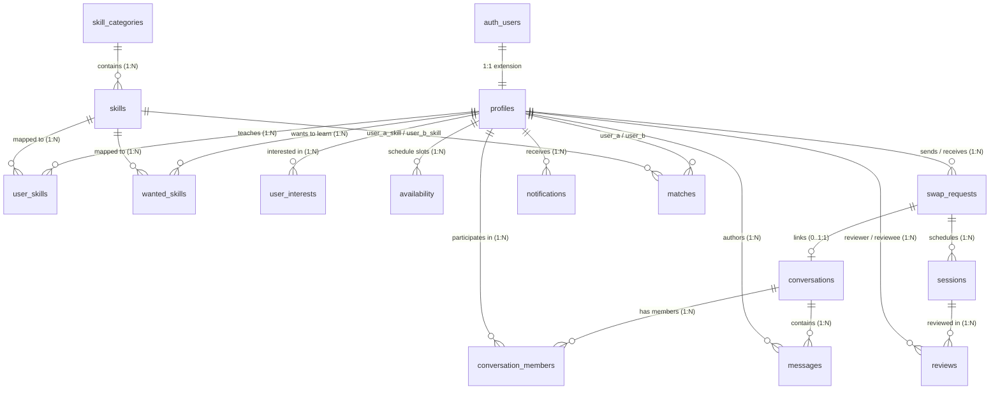

# SkillSwap Database Architecture & Schema Documentation 🗄️

This directory contains the complete, normalized PostgreSQL schema designed for **SkillSwap** on **Supabase**.

---

## 📐 Database Entity Relationship Overview

The schema is divided into 4 core functional domains across **15 normalized relational tables**:



---

## 🗃️ Complete Table Specifications

### 1. Identity & Profiles
- **`profiles`**
  - `id`: `UUID PRIMARY KEY REFERENCES auth.users(id) ON DELETE CASCADE`
  - `username`: `TEXT UNIQUE NOT NULL`
  - `full_name`: `TEXT NOT NULL`
  - `avatar_url`: `TEXT`
  - `bio`: `TEXT`
  - `location`: `TEXT`
  - `time_zone`: `TEXT DEFAULT 'UTC'`
  - `rating_avg`: `NUMERIC(3, 2) DEFAULT 0.00`
  - `rating_count`: `INTEGER DEFAULT 0`
  - `created_at`, `updated_at`: `TIMESTAMPTZ`

### 2. Skill Taxonomy & Preferences
- **`skill_categories`**
  - Canonical taxonomy grouping (e.g. Programming, Design, Languages, Music).
- **`skills`**
  - Specific canonical skills (e.g. React.js, Python, Spanish, Guitar).
- **`user_skills`** (Skills users teach)
  - Links `profiles` (User) to `skills`.
  - `proficiency_level`: `'beginner' | 'intermediate' | 'advanced' | 'expert'`
  - `experience_years`: `NUMERIC(3,1)`
  - Constraint: `UNIQUE (user_id, skill_id)` (Never stored in comma-separated fields!)
- **`wanted_skills`** (Skills users want to learn)
  - Links `profiles` (User) to `skills`.
  - `target_proficiency`, `priority`: `'low' | 'medium' | 'high'`
  - Constraint: `UNIQUE (user_id, skill_id)`
- **`user_interests`**
  - Broad hobby and subject interests beyond specific skills.
- **`availability`**
  - User weekly schedule: `day_of_week` (0-6), `start_time`, `end_time`, `time_zone`.
  - Constraint: `CHECK (start_time < end_time)`

### 3. Swaps, Matches & Sessions
- **`swap_requests`**
  - User A proposes skill swap to User B.
  - `sender_id`, `receiver_id`, `offered_skill_id`, `requested_skill_id`.
  - `status`: `'pending' | 'accepted' | 'rejected' | 'cancelled' | 'completed'`
  - Constraint: `CHECK (sender_id <> receiver_id)`
- **`matches`**
  - Algorithmic bilateral matches (User A teaches what B wants & B teaches what A wants).
  - Canonical ordering constraint: `CHECK (user_a_id < user_b_id)` prevents mirror duplicates.
- **`sessions`**
  - Specific scheduled swap sessions.
  - `swap_request_id`, `teacher_id`, `learner_id`, `skill_id`.
  - `meeting_link`, `scheduled_start`, `scheduled_end`, `status`.

### 4. Communication & Reputation
- **`conversations`** & **`conversation_members`**
  - Real-time chat channel between swap participants.
- **`messages`**
  - Real-time messages with timestamp triggers on parent conversations.
- **`reviews`**
  - Post-session rating (1-5 stars) and qualitative feedback.
  - Trigger automatically updates `rating_avg` and `rating_count` on `profiles`.
  - Constraint: `UNIQUE (session_id, reviewer_id)`.
- **`notifications`**
  - In-app event alerts (swap requests, acceptances, messages, session reminders).

---

## 🔒 Row Level Security (RLS) Model

All 15 tables enforce PostgreSQL Row Level Security:
1. **Public Data**:
   - `profiles`, `skill_categories`, `skills`, `user_skills`, `wanted_skills`, `user_interests`, `availability`, and `reviews` allow `SELECT` for discovery.
2. **User Ownership**:
   - Users can only `INSERT`, `UPDATE`, or `DELETE` their own skills, availability, and profile data (`auth.uid() = user_id`).
3. **Private Interactions**:
   - `swap_requests`: Visible only to `sender_id` or `receiver_id`.
   - `conversations` & `messages`: Restricted strictly to verified `conversation_members`.
   - `sessions`: Accessible only to `teacher_id` or `learner_id`.
   - `notifications`: Accessible only to the owning `user_id`.

---

## 🚀 How to Apply Migrations to Supabase

### Option A: Using Supabase Dashboard (Recommended)
1. Open your project on [Supabase.com](https://supabase.com).
2. Go to **SQL Editor** in the left sidebar.
3. Open `database/schema.sql` from this repository.
4. Copy and paste the entire script into the SQL Editor.
5. Click **Run**.
6. All 15 tables, triggers, indexes, RLS policies, and seed skills will be initialized immediately.

### Option B: Verify Connection from Terminal
Once you paste your credentials into `backend/.env`, verify with:
```bash
npm run db:verify
```
